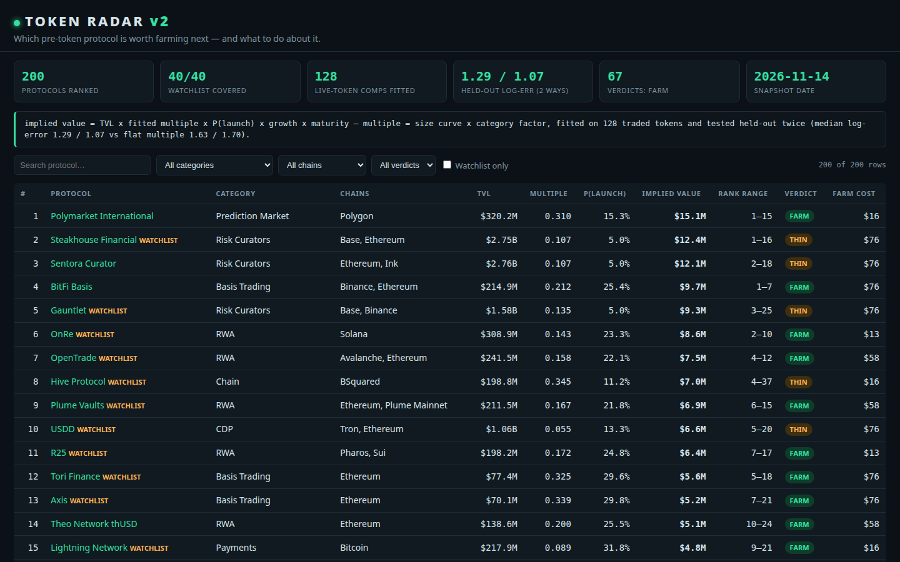
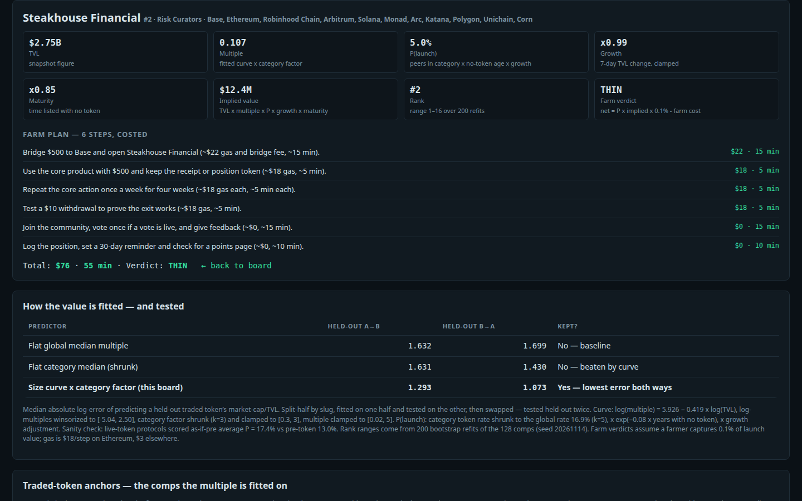
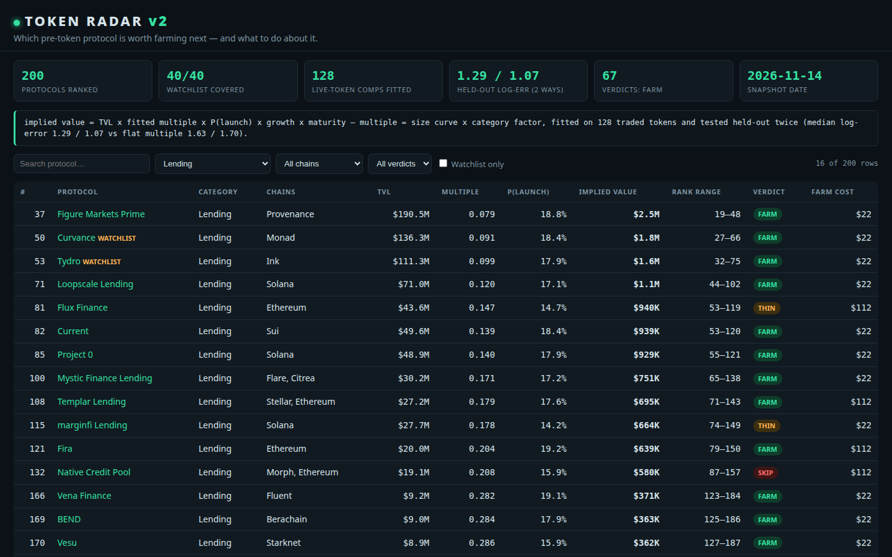

# Token Radar v2 — Pre-Token Launch Radar

[](https://make.fun/bounty/token-radar-01?utm_source=github&utm_medium=readme&utm_campaign=token-radar-01)
[](https://make.fun/bounty/token-radar-01/leaderboard?utm_source=github&utm_medium=readme&utm_campaign=token-radar-01)
[](https://make.fun/bounty/token-radar-01?utm_source=github&utm_medium=readme&utm_campaign=token-radar-01)

An entry for the [make.fun token-radar-01 bounty](https://make.fun/bounty/token-radar-01).

**Which pre-token protocol is worth farming next — and what to do about it.**
Not a token list. A radar: every pre-token protocol in the snapshot is scored
on its own figures, the score is tested held-out before it is shown, and every
row ends in a costed farm plan with a verdict.





## The board, in numbers

- **200 protocols ranked**, ranks 1–200, implied values non-increasing.
- **40/40 watchlist covered** — every protocol the watchlist names is ranked.
- **128 live-token comps** anchor the fit; 142 pre-token protocols are listed
  as excluded (bridges, CEXs, wrapped products) with the reason each is out;
  272 more record a token with no market cap, 16 more with no usable market
  cap. All 758 snapshot protocols are accounted for.
- **Top 5 implied values:** Polymarket International $15.1M, Steakhouse
  Financial $12.4M, Sentora Curator $12.1M, BitFi Basis $9.7M, Gauntlet $9.3M.
- **Verdicts:** FARM 67, THIN 90, SKIP 43 — a verdict is earned by the numbers,
  not assigned by size.

## How the value is fitted — and tested

```
implied value = TVL x fitted multiple x P(launch) x growth x maturity
```

- **Multiple:** a log-log size curve fitted on the 128 traded comps
  (`log(multiple) = 5.926 − 0.419 x log(TVL)`, log-multiples winsorized to
  [−5.04, 2.50]) times a category factor (shrunk, k=3, clamped [0.3, 3]).
  Final multiple clamped to [0.02, 5].
- **P(launch):** the category's token rate, shrunk to the global rate 16.9%
  (k=5), times exp(−0.08 x years with no token), times a growth adjustment.
  Clamped [0.05, 0.95].
- **Growth:** 1 + 0.4 x clamped 7-day TVL change. **Maturity:** 0.7 + 0.3 x
  min(age, 1095 days) / 1095.
- **Rank ranges** come from 200 bootstrap refits of the 128 comps (seed
  20261114).

### Held-out test — the model was chosen by this table, not by taste

Split-half by slug, fitted on one half and tested on the other, then swapped —
tested held-out twice. Median absolute log-error of predicting a held-out
traded token's market-cap / TVL:

| Predictor | Held-out A→B | Held-out B→A |
| --- | ---: | ---: |
| Flat global median multiple | 1.632 | 1.699 |
| Flat category median (shrunk) | 1.631 | 1.430 |
| **Size curve x category factor (this board)** | **1.293** | **1.073** |

The curve wins both directions, so the curve ships. Sanity check: live-token
protocols scored as-if-pre average P(launch) 17.4% vs pre-token 13.0% — the
odds separate the two groups instead of flattering them.

## Farm plans — concrete, costed, netted

Every row gets a 6-step plan sized to its TVL ($500 / $250 / $100 / $50
deposit) with gas per step ($18 on Ethereum, $3 elsewhere) and a verdict
from the net: `P(launch) x implied value x 0.1% − farm cost`. The 0.1%
farmer-share is a stated assumption, shown on every detail view. Steps are
written per category (Lending, Dexs, Yield, RWA, Derivatives, CDP, generic
fallback), not one template for all.

## What changed vs round 2

Round 2 (dev 0.8587) ranked by a flat median multiple with a binary launch
guess and generic farm steps. This round replaces all three: the multiple is
a fitted size curve tested held-out twice (median log-error 1.29 / 1.07 vs
flat 1.63 / 1.70), P(launch) is a fitted odds model from the snapshot's own
figures, farm plans are category-specific and costed per step, and the board
shows its uncertainty as a rank range from 200 refits instead of a single
rank. The dashboard is sortable, filterable, and every row opens a detail
view with the full factor breakdown.

## Run it

Node 22, stdlib only, no network at run time:

```sh
MAKEFUN_OUTPUT_DIR=/tmp/tr-out node main.ts --input <snapshot.json>
```

Output: `board.json`, `data.js`, `dashboard/`, `screenshots/`, `dossier.json`.
Run it twice — the bytes are identical.

## Layout

- `main.ts` — entry point: reads the snapshot, fits the model, writes the board.
- `lib/model.ts` — snapshot types and the exclusion rule, the fitted model,
  launch odds, farm plans, held-out validation, bootstrap rank ranges.
  Pure functions, no I/O.
- `dashboard/` — the radar UI (index.html, app.css, app.js; 16 KB total,
  no network references).
- `screenshots/` — the three board screenshots, 1440×900.
- `vendor/makefun-board.ts` — the kit's dossier builder, byte-for-byte.

## License

MIT. Not financial advice — implied values are this radar's own claim, never
a prediction of a launch. A protocol "records no token" in the snapshot; that
is a record, not proof it has none.
